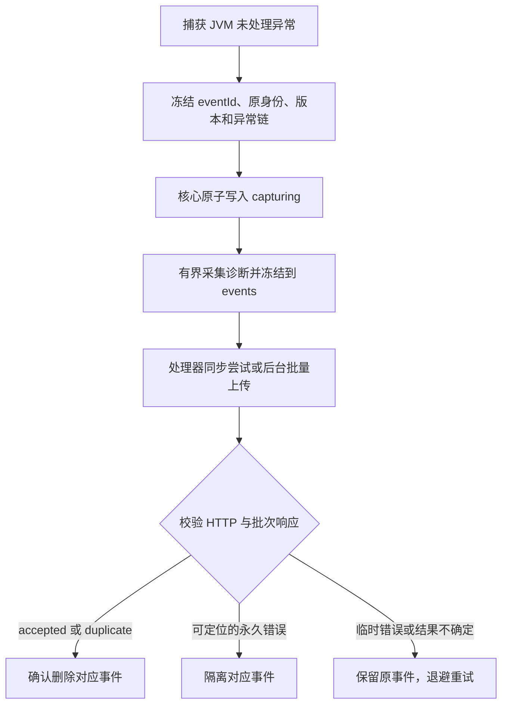

# Android Crash 上传接入

本文维护 JVM 与 Native 致命 Crash 的客户端捕获、持久化与确认流程。正式字段和示例见 [Crash API](../api/crash-api.md#批量上报)，错误码见[上报错误码](../api/crash-error-codes.md)，完整字段约束见 [Crash v2 JSON Schema](../../backend/src/main/resources/schema/crash-event-v2.schema.json)。Native 已完成 API 29/35 模拟器重启补传和隔离服务查询；其他设备与生产边界以[分阶段验证](../validation/native-crash/README.md)为准。

## 使用现有 SDK

按[客户端接入入口](README.md#使用现有-sdk)完成模块选择和初始化。全量 SDK 的 Crash 开关、批次与重试配置见 [SDK 配置指南](../../android/docs/knowledge-base/16-SDK配置指南.md)；只接入 Crash 时使用[模块化说明](../../android/docs/knowledge-base/15-SDK模块化拆分说明.md)中的公开组件。

现有实现由 [CrashReporter](../../android/performance-crash/src/main/java/com/shanshui/performance/crash/CrashReporter.kt)、[FileCrashQueue](../../android/performance-crash/src/main/java/com/shanshui/performance/crash/FileCrashQueue.kt)和 [CrashUploader](../../android/performance-crash/src/main/java/com/shanshui/performance/crash/CrashUploader.kt)负责；异常 Handler 在 `CrashReporter` 内注册。捕获与启动顺序见 [Android Crash 调用链](../../android/docs/knowledge-base/03-Crash采集与上报.md)。

## 事件构造与持久化

直接实现采集端时遵守以下边界：

1. `UncaughtExceptionHandler` 保留异常线程和系统 TID，先将已脱敏的核心异常及线程/进程身份原子写入 `capturing`，再等待预建工作者采集其他线程、日志、内存、FD 和设备环境，冻结到可上传的 `events`。主异常与各分区的 JSON 契约、状态和字节限额见 [Crash API](../api/crash-api.md#批量上报)。
2. 处理器最多等待辅助采集 1500ms；logcat 共享最多 500ms。等待结束后冻结一次，不接纳迟到快照。原子写入完成后，处理器可同步尝试上传最多一批、等待最多 3500ms；正常启动和网络恢复也会触发后台上传。等待预算不是 ART 栈采集、文件系统或进程终止的硬中断保证。
3. 处理结束交回此前的系统异常 Handler，保持 Android 原有进程终止语义。下次启动先恢复未冻结核心，再安排上传；保留原事件身份和发生时间，未完成分区标记 interrupted，不把新进程现场冒充旧现场。
4. Native 使用 `crash.kind=native` 和独立 `nativeCrash`，不携带 JVM 异常链；完整 ANR 和非致命异常不包装成致命 Crash。

### Native 接入与上传字段

默认 `CrashConfig(nativeEnabled = true)`；如不启用新 Native 监听，可设置为 `false`，已有 Native 暂存仍会在启动时恢复。宿主需启用原生库解压，例如在应用打包配置中设置 `packaging { jniLibs.useLegacyPackaging = true }`，确保 `libapm_crash_dumper.so` 可从安装目录执行；不需要单独引入 Native Tools。支持的 ABI、信号和截止边界见 [Android Crash 专题](../../android/docs/knowledge-base/03-Crash采集与上报.md#native-信号与原始现场)。

Native 事件尽力上传原始信号/code、故障地址、寄存器、ABI、崩溃 TID、主回溯、模块名称与 ELF Build ID；SIGABRT 可附安全取得的有限 abort 消息。共享诊断包括其他 Native 回溯、Java 线程快照及可可靠关联的主 Java 栈、logcat main/system/events、Java/Native 堆与进程内存用量、受限 meminfo/status/limits、FD 类别、进程和设备信息。未知的 Java/Native 对应关系标记 `unknown`，各分区携带实际采集状态和时间。

SDK 不生成或上传原始 `stack` 内存、`memory near` 和完整 `memory map` 转储，也不先保存完整 tombstone 再过滤。日志与 abort 消息在首次落盘前过滤已识别的凭据和转储样式；abort 消息仅保留完整、最多 255 字节的可打印 ASCII，其余情况省略。Native 事件在下次启动冻结并复用既有批量响应和重试；暂存读取等瞬时失败会在后续后台上传前再次恢复，正常退出或被系统结束后遗留的空预留会在确认原进程退出后回收。重试不重新采集，不因 mapping 变化重写。Native SO 符号文件上传和符号还原留待后续实现。

事件身份、App Key 和隐私规则统一见[接入公共规则](README.md#事件身份生命周期)。不要把原始硬件标识、账号、令牌、业务请求正文或完整 URL 放入设备标识、异常消息和属性中。

## 启动事件与会话

新会话发送 `eventType=app_start`，使用与该会话 Crash 相同的公共字段和 `sessionId`，不携带 `crash` 载荷；不能每次网络重试重新生成启动事件。SDK 的启动上报实现和多进程边界见 [Crash 专题](../../android/docs/knowledge-base/03-Crash采集与上报.md)。

启动事件用于会话分母；遗漏分母时不能把无崩溃率解释为正常值。统计公式和 `denominator_insufficient` 的正式语义见 [Crash API](../api/crash-api.md#统计公式)。

## 上传与队列确认

请求发送到 `POST /ingest/v1/batches`，正文为 UTF-8 JSON v2 批次；诊断现场放在每条事件的 `crash.diagnostics` 中。完整字段和[合成请求样例](../examples/crash-diagnostics-batch.json)见 [Crash API](../api/crash-api.md#批量上报)。当前 SDK 默认发送普通 JSON；服务端支持 gzip，手动压缩时才设置 `Content-Encoding: gzip`。SDK 冻结前同时按事件 240 KiB 目标和实际批次大小校验，服务端另按 256 KiB 单事件及分区限制校验。

发送后执行[批量响应与队列确认](README.md#批量响应与队列确认)，再更新本地事件状态。Crash 必须核对返回 `requestId`；一条事件可以有多个字段错误，拒绝数量按不同事件归并，不按错误数组长度计算。非预期成功响应、计数不一致或无法定位的错误保留整批进入有上限的重试，不凭 HTTP 200 删除数据。

批次级永久错误没有逐事件定位时，隔离受影响批次并修复配置或内容；不清空其他正常队列。网络不确定结果保留原 `eventId`、版本、发生时间及完整冻结载荷；不能用同一事件 ID 补充新的诊断现场，否则返回永久 `CRASH_CONTENT_CONFLICT`。离线队列的保留时间必须结合服务端接收窗口配置，超期事件不反复重传。

accepted 只表示 Crash 事实和初始 pending 原始链已持久化；mapping 已存在也不代表本次接收同步完成还原。客户端不因后台排队、等待 mapping 或处理失败重新生成事件。构建归属和首次成功固定规则见 [mapping 接入](symbol-mapping.md)。

## 联调检查

- JVM 致命异常先落盘，断网或进程终止后在新进程恢复；重复上传不重复增加统计。
- 同一批次的合法事件和永久错误正确分流；缺失/错误 `requestId`、错误计数、越界索引及索引与 `eventId` 冲突均不能误删队列。
- 错误 Key、错误包名、非法 `processId`、过期时间、超限事件和不支持的 Crash 类型按正式错误语义隔离；可重试错误保留原数据。
- 发布 APK、`buildId` 与 mapping 同次生成；Crash 接收确认和后台还原完成分别验收。

当前构建、主机与设备验证范围见 [Android 构建测试](../../android/docs/knowledge-base/11-构建测试与本地发布.md)；真实网络、重启和持久化缺口见 [Android 待验收事项](../../android/docs/knowledge-base/12-常见问题与待验证事项.md#客户端接入待验收)。手动 HTTP 联调使用 API 中的请求示例，避免另维护一份字段表。
