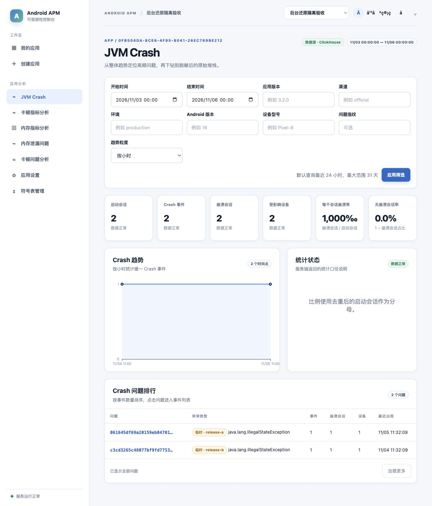
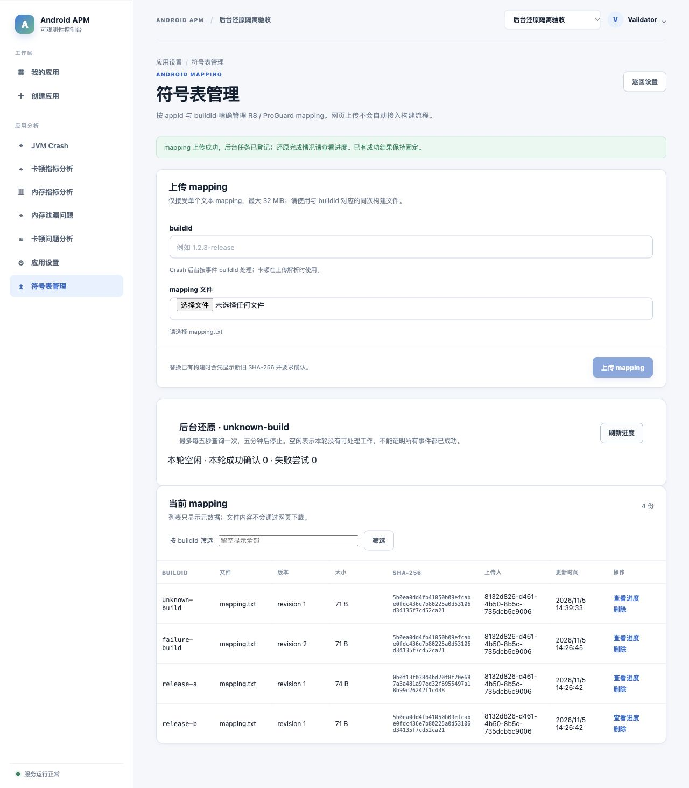
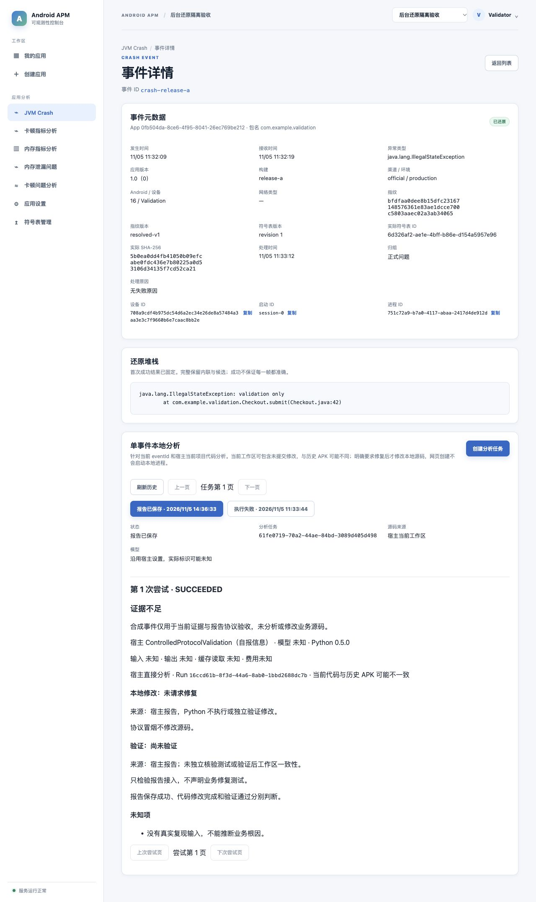

# Crash 后台还原隔离验收

## 环境与证据范围

2026-11-05 使用当前工作区源码、JDK 21.0.11、PostgreSQL 16-alpine、ClickHouse 26.7.3.19、R8 8.9.35、Node 24.19.0 和 Python 3.12.14。所有数据、身份和 mapping 均为合成样本。专用 PostgreSQL/ClickHouse 容器、后端 18081、Vite 15173、MCP 13010、故障代理 18124 及文件目录均与现有开发/云端隔离；本任务没有部署或修改现有业务数据。

空库执行 PostgreSQL V1～V15、ClickHouse 001～008，后端启用真实 ClickHouse 存储、查询与分析开关。HTTP 故障代理仅转发到隔离 ClickHouse，用于在实际 INSERT 后丢弃确认或在事实 INSERT 前返回 503，不模拟数据库结果。端到端失败样本将 R8 输出上限调低至 512 字节以稳定触发 output_limit；生产默认仍为 1 MiB。Java 验收运行使用构建 JAR 的独立副本，避免后续构建覆盖运行文件。

## 完整 HTTP 链路

| 场景 | 实际结果 |
|---|---|
| 缺少 mapping | 两构建各一启动/Crash，accepted=4；pending/raw_chain，两个 tmp-v1 临时问题 |
| 后补 mapping | 网页上传先返回已登记，进度由 queued 推进；两个构建还原为相同正式指纹，Issue 事件数=2；旧临时事件页为空 |
| 事实统计 | 处理前后均为 2 启动、2 Crash、2 崩溃会话、2 设备；发生时间、接收时间和原日期不变 |
| 首次成功固定 | 删除后详情完全相同；重传新 symbolId/revision=1，内容、指纹、实际来源及 processedAt 均不变；旧客户端原批次重放 accepted=0/duplicate=4 |
| 已有 mapping 的新事件 | 接收不做同步还原，后续后台成功使用新文件；旧事件继续保留原来源 |
| 确定性失败后替换 | 合法 mapping 扩大输出触发 failed/output_limit，保留 raw_chain；revision=2 的正确文件唤醒同事件并成功，无需重新上报 |
| 迟到事件 | 比已处理事件更早三天的事件仍成功回填，occurredAt 保持原日期 |
| 部分接收 | pending 状态已写，事实 INSERT 注入失败返回 503，孤立状态详情为 404；原 eventId 重试补齐事实后 accepted=1 并后台成功 |
| 发布确认未知与重启 | 成功 INSERT 已真实落库但代理丢弃确认，PostgreSQL 保留一份 pending_payload；正常停止/重启后按原登记重放，读回确认后清载荷，完整详情与重启前一致 |
| Jank/Memory 回归 | 无 mapping 的当前 v3 ZIP 接受并可读详情；内存样本 PSS=0 被保留，未进入 Crash 工作队列。ZIP 由仓库旧数字 PID 夹具改写为 UUID/主线程及正确摘要，不能当作未经修改的真机样本 |

## 消费者与协调切换

后端、网页、MCP 与 Worker/Skill 在相同隔离环境使用当前契约。官方 MCP 客户端通过真实 Streamable HTTP 发现 19 个工具，读取 stack 的内容与网页详情逐项一致，实际来源仍指向首次成功文件；旧片段返回 INVALID_SECTION。

统一 `apm_analysis.py` 启动器使用独立状态目录和成对环境变量，未修改已安装 Skill 本地配置或真实凭据。真实 prepare 领取证据版本 3 的 retrace_text，提交受控“证据不足”报告版本 4 后为 SUCCEEDED；工具关闭与宿主 UNKNOWN 分开，实际结束合成验收后通过管理员接口核验停止。不调用模型或修改业务源码，不能推导分析准确率或修复质量。

隔离库另存旧 Crash、旧启动会话和 contract_version=NULL 的旧证据任务。当前统计不增加，旧 Crash 详情 404；旧任务不在网页列表，网页详情及 Worker inspect/claim 均 404，旧 evidence_text 原字节保留。符号表元数据提交后回执丢失的真实 PostgreSQL/MockMvc 测试另确认：API 返回 503，但已提交的文件引用与文件均保留，不按异常推断回滚删除。

真实 V14→V15 的旧字节、局部唯一、删除审计与重复迁移由 BackgroundCrashMigrationPostgresTests 验证。切换前必须实际停止在途宿主任务；当前工具拒绝旧本地协议而不升级缓存，旧数据不转换、不自动清空。

恢复顺序、备份边界及切换方法统一维护在[部署主题](../../knowledge-base/07-部署与运维.md#crash-后台还原协调切换与独立恢复)。本验收不提供旧程序兼容或降级路径，也不证明生产备份恢复、HTTPS、多实例文件协调、长期 TTL 成本或 SLA。

## 积压混合负载

同一隔离后端另建应用，ClickHouse 生成一百万事实/状态、十个构建、六天历史、初始 100% pending，每条原始链 2254 字节。等待后台进入 running 后，前台十次一天以上窗口概览与三次幂等 mapping 上传并行。上传耗时分别为 15.46、13.50、14.69 ms；前台耗时 48.36～91.40 ms，均返回完整统计。采样时只有一个 running 构建，未确认载荷 0 条/0 字节。批次最多 100、共享 R8 许可及发布背压另由自动化验证，不能把采样为零理解为没有背压需求。

该场景的 R8 输出上限为受控 512 字节，后台遇到超限失败；它验证上传不会等待百万历史处理，不代表百万成功还原吞吐。专项结束后删除该合成 mapping，使余下积压稳定等待。默认预算下的独立百万候选与前台关联计划、read_rows/read_bytes、耗时/内存及预算拒绝统一见[性能专题](../../../backend/docs/knowledge-base/crash-query-performance-baseline.md)。测量 SQL 和临时日志位于忽略的 backend/build，凭据及原日志不进入仓库。

## PC 网页截图

截图来自真实后端；组件测试负责权限、冲突、请求取消、轮询上限及恶意文本转义，不以组件替代浏览器证据。浏览器核验了临时问题、上传先登记、后台进度、固定详情、当前分析报告与删除重传。当前进度是本轮计数，重复对账开启新轮后可为零，idle 不是“全量成功”。







## 自动化复验

从仓库根目录执行后端完整测试；真实 PostgreSQL/ClickHouse 均由 Testcontainers 隔离。百万专项须显式开启，结果不并入默认通过数：

```bash
JAVA_HOME="$(/usr/libexec/java_home -v 21)" GRADLE_USER_HOME="$PWD/.gradle-local" \
  bash backend/gradlew -p backend test bootJar --no-daemon
RUN_CRASH_BENCHMARK=true JAVA_HOME="$(/usr/libexec/java_home -v 21)" GRADLE_USER_HOME="$PWD/.gradle-local" \
  bash backend/gradlew -p backend test --tests '*BackgroundCrashQueryPerformanceTests' --no-daemon
```

前端执行 npm test、npm run typecheck、npm run build；MCP 执行 npm test、npm run typecheck；Worker 在其目录执行 uv run --locked pytest。当前完整数字与条件跳过分别以[后端测试](../../../backend/docs/knowledge-base/06-测试与质量保障.md)、[前端测试](../../../frontend/docs/knowledge-base/06-测试与质量保障.md)为准。OpenSpec 严格验证、文档本地链接及 git diff --check 属于交付检查，不代表生产验收。

## 文档同步归属

以下仅列本变更同步的主题，未改动的现有端口文档保留用户原修改。其他资料包括 Worker/Skill、MCP README、固定集和运维初始化说明。

### 根知识库

- [00-当前实现与验证边界.md](../../knowledge-base/00-当前实现与验证边界.md)
- [02-总体架构与模块.md](../../knowledge-base/02-总体架构与模块.md)
- [03-事件模型与数据存储.md](../../knowledge-base/03-事件模型与数据存储.md)
- [04-上报协议与可靠性.md](../../knowledge-base/04-上报协议与可靠性.md)
- [05-查询与Dashboard.md](../../knowledge-base/05-查询与Dashboard.md)
- [07-部署与运维.md](../../knowledge-base/07-部署与运维.md)
- [08-测试与质量保障.md](../../knowledge-base/08-测试与质量保障.md)
- [09-实施路线图.md](../../knowledge-base/09-实施路线图.md)
- [10-架构决策记录.md](../../knowledge-base/10-架构决策记录.md)
- [11-术语表.md](../../knowledge-base/11-术语表.md)
- [13-待确认事项.md](../../knowledge-base/13-待确认事项.md)
- [README.md](../../knowledge-base/README.md)

### 后端知识库

- [00-当前实现与验证边界.md](../../../backend/docs/knowledge-base/00-当前实现与验证边界.md)
- [02-接收解析与查询链路.md](../../../backend/docs/knowledge-base/02-接收解析与查询链路.md)
- [03-持久化与数据库迁移.md](../../../backend/docs/knowledge-base/03-持久化与数据库迁移.md)
- [05-构建配置与本地运行.md](../../../backend/docs/knowledge-base/05-构建配置与本地运行.md)
- [06-测试与质量保障.md](../../../backend/docs/knowledge-base/06-测试与质量保障.md)
- [crash-query-performance-baseline.md](../../../backend/docs/knowledge-base/crash-query-performance-baseline.md)
- [local-analysis.md](../../../backend/docs/knowledge-base/local-analysis.md)
- [symbol-mapping.md](../../../backend/docs/knowledge-base/symbol-mapping.md)

### 前端知识库

- [01-产品范围与当前状态.md](../../../frontend/docs/knowledge-base/01-产品范围与当前状态.md)
- [03-页面路由与交互.md](../../../frontend/docs/knowledge-base/03-页面路由与交互.md)
- [04-API数据模型与状态管理.md](../../../frontend/docs/knowledge-base/04-API数据模型与状态管理.md)
- [06-测试与质量保障.md](../../../frontend/docs/knowledge-base/06-测试与质量保障.md)
- [local-analysis.md](../../../frontend/docs/knowledge-base/local-analysis.md)

### API 文档

- [README.md](../../api/README.md)
- [agent-query-api.md](../../api/agent-query-api.md)
- [analysis-api.md](../../api/analysis-api.md)
- [app-api.md](../../api/app-api.md)
- [crash-api.md](../../api/crash-api.md)
- [mcp-api.md](../../api/mcp-api.md)
- [symbol-api.md](../../api/symbol-api.md)

### 客户端文档

- [crash-client-integration.md](../../client-integration/crash-client-integration.md)
- [symbol-mapping.md](../../client-integration/symbol-mapping.md)
