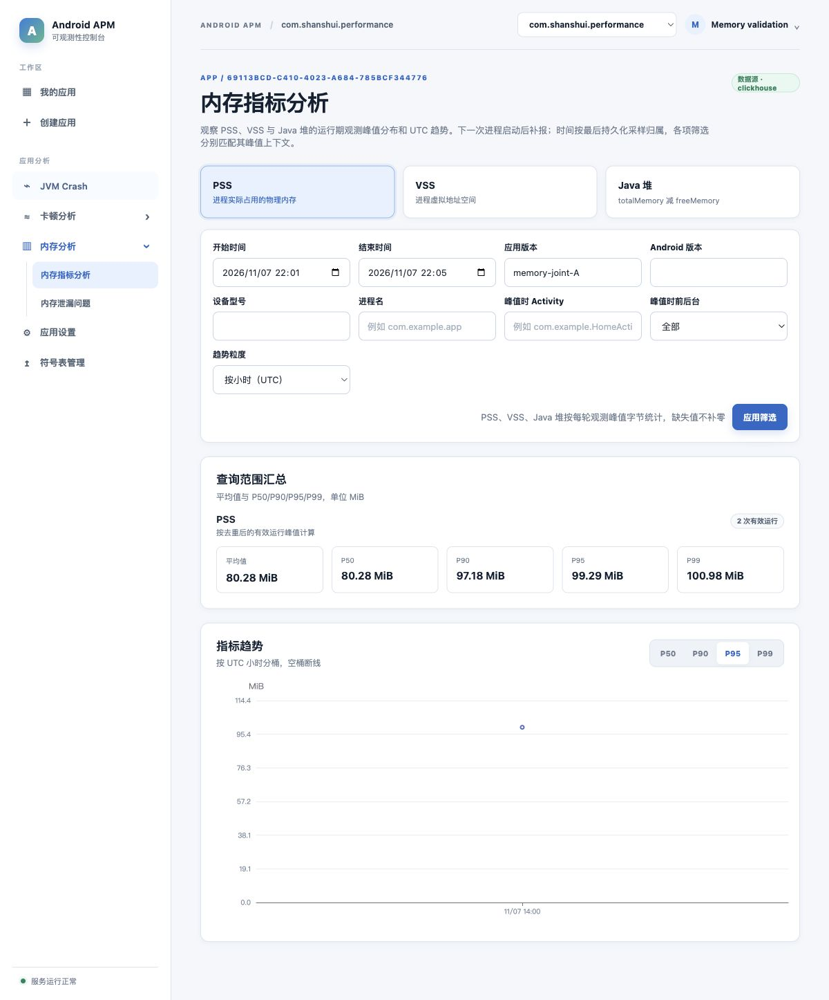

# 内存运行峰值独立与联合验收

本资料是阶段 S 与共同阶段 J 的唯一验收入口，日期为 2026-11-07。服务端独立验证覆盖真实 Servlet HTTP、ClickHouse、Session/Agent、官方 MCP 和三个 PC 视口；联合验证使用用户指定的 Pixel_6 模拟器、真实 SDK 和隔离持久库，J1..J7 已通过。没有部署现有本地服务或云端。

源码基线为 `031686fac9a8486e0e1dcb967130e4c0c75f3d89` 加本工作区 `report-memory-runtime-peaks` 未提交变更；规划入口为[服务端任务](../../../openspec/changes/archive/2026-11-08-report-memory-runtime-peaks/tasks.md)。后续复验应记录实际提交版本，不能只沿用此处基线。

两端已于2026-11-08完成verify和归档，正式规格已同步。核验报告：[服务端](../../../openspec/changes/archive/2026-11-08-report-memory-runtime-peaks/verification.md)、[客户端](../../../openspec/changes/archive/2026-11-08-report-memory-runtime-peaks-android/verification.md)（仓库内引用）。服务端无阻塞问题，有1项增强页签专门自动化覆盖的建议；客户端无问题。归档仅整理规格和证据，没有重新执行设备实验、提交Git或部署。

## 协议与共享样例

字段、错误与统计口径以[内存 API](../../api/memory-metrics-api.md)为准，客户端生命周期目标见[接入说明](../../client-integration/memory-metrics.md)。[共同事件 JSON](../../fixtures/memory-runtime-peaks.json)和[固定数据集](../../datasets/memory-fixed-dataset.md)用于两端契约测试，固定时间必须随测试时钟整体平移。

本次使用 `009_memory_runtime_peaks.sql`，没有改写旧迁移；旧表保留且不参与峰值查询。运行数为 `runCount`，时间归属为原运行 `lastSampledAt`，场景/前后台分别匹配各项峰值；客户端 current 只在下一进程启动时封存补报。

## 最近完整回归

后端完整test为316项，其中313通过、3项条件跳过、无失败；跳过为未启用的Crash百万候选、符号表性能和缺少外部mapping的Retrace专项，详见[后端测试页](../../../backend/docs/knowledge-base/06-测试与质量保障.md)。本次所有内存峰值专项均执行通过。前端47文件/156项、类型检查和生产构建通过；MCP20项及类型检查通过。

## 自动化与真实链路

| 检查 | 方法和结论 |
|---|---|
| 写入与重试 | [持久化专项](../../../backend/src/test/java/com/shanshui/apmserver/MemoryPeakPersistenceTests.java)：批内重复、首次并发、跨应用相同ID、重建适配器/跨接收日重试、写入前失败及写入成功但响应丢失；原版本、buildId、UUID身份与三项上下文恢复一致 |
| 未完成后台合并 | 停止表合并并直接写入相同事件的物理重复行；原始表存在两行，`FINAL` 查询只贡献一轮，不能依赖后台合并已经完成 |
| HTTP持久化 | [真实HTTP专项](../../../backend/src/test/java/com/shanshui/apmserver/MemoryPeakHttpIntegrationTests.java)：五轮固定集首次accepted=5，重放duplicate=5；PSS有效运行4，平均/P50=150，P95=285；相同时间窗的旧样本大值不参与统计 |
| 网页与Agent | Session与Agent HTTP在同一范围下返回相同summary/trend，scene=A且foreground=true仅PSS计数；真实故障返回503，可重试而非空成功；扫描预算耗尽返回422 |
| MCP | [官方客户端验收脚本](../../../mcp-server/scripts/verify-memory-runtime-peaks.mjs)通过真实MCP HTTP连接实际Java Agent；概览、趋势、三种上下文筛选与直接HTTP一致，错误Token明确失败。Token仅经标准输入传递，不出现在命令行或证据文件 |
| MCP契约 | 内存工具拒绝sampleCount旧响应、缺失/负数/非整数runCount；保留零、null和重试错误。输入长度与当前后端一致，不扩大其他工具的边界 |
| 查询性能 | 目标十万轮，加其他应用和历史月份二十万轮；裁剪后实际扫描十万行，概览返回一行；精确统计、745桶上限及扫描/内存/响应/时间预算均通过。详情见[查询资源证据](../../../backend/docs/knowledge-base/backend-api-query-validation.md#内存运行峰值查询边界) |

“重建适配器”验证重新查重依赖持久库，不等同于重启ClickHouse服务器。并发证据限单实例同步协调；此次不证明多实例写入原子性、生产并发或数据库灾难恢复。

## 复验命令

前置条件为 Java 21、可用 Docker、Node 满足 `mcp-server/package.json` 的版本约束，以及两个 Node 工程已按各自锁文件安装依赖。以下从仓库根执行；Wrapper 当前没有可执行位，因此通过 bash 启动：

```bash
npm --prefix mcp-server run build
APM_MEMORY_MCP_VERIFY=true bash backend/gradlew -p backend test --tests '*MemoryPeak*Tests' --console=plain
bash backend/gradlew -p backend test --console=plain
npm --prefix frontend test
npm --prefix frontend run typecheck
npm --prefix frontend run build
npm --prefix mcp-server test
npm --prefix mcp-server run typecheck
openspec validate report-memory-runtime-peaks --strict
```

普通后端完整测试不依赖MCP构建；显式设置 `APM_MEMORY_MCP_VERIFY=true` 才执行跨运行时MCP步骤，需先构建该工程。所有持久化测试自行启动隔离Testcontainers；不需要现有服务器的密码或App Key。条件专项跳过必须按后端测试页分别说明，不能写成已通过。

需要浏览器复验时，在专项命令前额外设置 `APM_MEMORY_VISUAL_HOLD=true`。测试成功后会把不含凭据的临时后端地址和应用ID写入 `backend/build/memory-peak-visual.json`，并等待最多15分钟。用 `VITE_BACKEND_PROXY_TARGET` 指向该临时地址启动Vite，测试登录账号来自测试资源中的公开占位配置。用版本 `visual` 查询可读MiB样例；创建 `backend/build/memory-peak-visual.done` 后测试正常退出并清理容器。不得把这些临时地址或测试配置用于生产。

## 页面证据

截图使用真实Java后端和真实ClickHouse，版本visual的四轮PSS峰值为32/64/96/128 MiB：平均/P50=80.00，P90=118.40，P95=123.20，P99=127.04。该版本与用于精确字节断言的共同固定集分开筛选。页面显示“运行期观测峰值”、下次启动补报说明、4次有效运行和峰值时上下文标签。

- [1280像素](../../../frontend/docs/knowledge-base/evidence/memory-runtime-peaks-1280.jpg)
- [1440像素](../../../frontend/docs/knowledge-base/evidence/memory-runtime-peaks-1440.jpg)
- [1920像素](../../../frontend/docs/knowledge-base/evidence/memory-runtime-peaks-1920.jpg)

三种宽度的筛选与卡片均可见，无横向裁切；1440/1920检查scrollWidth等于视口宽度。浏览器还验证P95切换及scene=A/前台筛选，PSS保留4轮而VSS为空，未把另一指标的上下文用于筛选。

Vitest的模拟响应只作为组件/状态测试；以上三个视口截图没有使用模拟API，采用独立合成固定集。实际 SDK 联合截图与结论见下节，两种证据不能互相替代。

## 共同阶段 J 结论

环境为用户指定的 Pixel_6 AVD、API35、arm64-v8a，包名 `com.shanshui.performance`。服务端使用临时 Servlet、H2 管理/Session 和 ClickHouse 26.7.3.19，应用授权由实际管理 API 创建；没有使用旧本地服务的内存模式。客户端基线 `9bdd1b79d4d9a5e1e6d532a5a6d7c311055d1f61` 加本次未提交变更，与服务端上述基线配套。A/B 的版本、buildId、APK SHA-256、事件/身份/载荷哈希、聚合结果及恢复断言保留于[脱敏结果](joint-result.json)，不保存原事件、设备身份、Key 或 Token。

| 检查 | 实际证据和结论 |
|---|---|
| J1 当前轮 | 默认10/30秒真实 Reporter，24MiB 合成负载上涨/释放、Activity 重建、前后台及网络开关恢复、flush；身份不变、峰值不回退，events 为空，代理无当前轮请求、数据库无当前轮 |
| J2 启动中断 | SIGKILL 真实进程；Debug 探针调用生产存储，分别在封存写入前、封存完成但删除 current 前终止。旧 current 保留，后一边界 current/events 同 ID，正常重启识别原记录而非创建第二事件 |
| J3 重试确认 | 旧 A1 先收到503，再由真实后端写入后丢弃响应；原载荷、版本、身份及 ID 不变，按持久化退避重试，最终 duplicate 后才清理文件；三次请求只贡献一轮 |
| J4 升级归属 | A2 在封存中断后覆盖安装 B/code2，实际上传和入库仍是 A/code1 的 buildId/sessionId/processId。B 的 current 为新 ID，始终无请求且未入库 |
| J5 一致查询 | 原 A1/A2 的三项峰值逐字段对齐 ClickHouse；按各自前后台/场景独立计算均值、P50/P90/P95/P99和 UTC 桶，与 HTTP/Agent/官方 MCP 一致。共同五轮固定集仍证明 PSS=4、平均150、P95=285及旧表隔离。网页三指标均为2轮，P95切换、后台无数据和恢复全部筛选均通过 |
| J6 契约/故障 | HTTP 复验8天接受、90天过期和未来拒绝、部分指标及真实0、非法身份400、错误包名403/Key401、旧类型400；其他事件仍按7天拒绝。真实存储失败上报/查询503，恢复后accepted/duplicate；恰好90天及前1毫秒的精确边界由固定时钟单元测试证明 |
| J7 采样开销 | 复核客户端已完成的八段各10分钟实验和完整采集/比较/可靠写盘路径，确定前台10秒/后台30秒；唯一性能结果与原始实验入口见[客户端测试页](../../../android/docs/knowledge-base/11-构建测试与本地发布.md#运行期内存峰值验证) |



页面 PSS 平均/P50/P90/P95/P99 为80.28/80.28/97.18/99.29/100.98 MiB，VSS 为16501.43/16501.43/16550.38/16556.50/16561.39，Java堆为20.67/20.67/30.15/31.34/32.28；来自此次两轮真实采集，不能作为固定设备内存基线。URL 初次保留毫秒范围，应用筛选后按现有分钟控件序列化；两者均包含这两轮。

工具退出已恢复原 APK、仪器 APK、网络开关和原内存目录，并逐文件比较原目录哈希一致。密集查询触发正常 Agent 限流时，验收工具只按 `Retry-After` 有界等待，不修改生产限流。模拟器结果不证明真机功耗、跨 ROM、绘制帧因果、突然断电或生产容量；采样间隔内瞬时上涨和最后未持久化更新仍可能丢失。两端已完成verify/archive，归档不会扩大上述验收范围。

## 联合验收复验工具

[联合工具](../../../scripts/verify-memory-runtime-peaks.py)由真实 HTTP 专项通过标准输入传入临时应用授权，配合 Performance 的 `MemoryJointPreparationTest` 与 Debug 专属 `MemoryJointStartupFault` 驱动用户指定的 Pixel_6 模拟器。需提前启动该 AVD，并保证 `emulator-5554` 对应它，客户端位于平台仓库 `android/`（默认）；显式其他检出可设置 `PERFORMANCE_PROJECT_DIR`，且 `android`、`adb` 在 PATH 中。

```bash
npm --prefix mcp-server run build
APM_MEMORY_JOINT_VERIFY=true APM_MEMORY_MCP_VERIFY=true \
  bash backend/gradlew -p backend test --tests com.shanshui.apmserver.MemoryPeakHttpIntegrationTests --rerun-tasks
```

工具备份原应用和仪器 APK，将原内存目录移开后使用专属测试目录；退出时恢复原目录并逐文件比较内容哈希，恢复 APK 和网络状态。上报密钥不进入命令行、页面协调文件或提交证据。失败原始材料只保留于权限受限的系统临时目录，不能提交。

HTTP/数据库/MCP 通过后，`backend/build/memory-peak-joint.json` 提供不含凭据的临时地址、应用 ID 和查询条件。使用 `VITE_BACKEND_PROXY_TARGET` 指向该地址启动独立 Vite，登录公开测试账号，按同一版本和时间窗检查实际设备峰值；完成页面检查后创建 `backend/build/memory-peak-joint.done`，工具才执行恢复并结束。该流程不更新现有本地 Docker 或云端。
