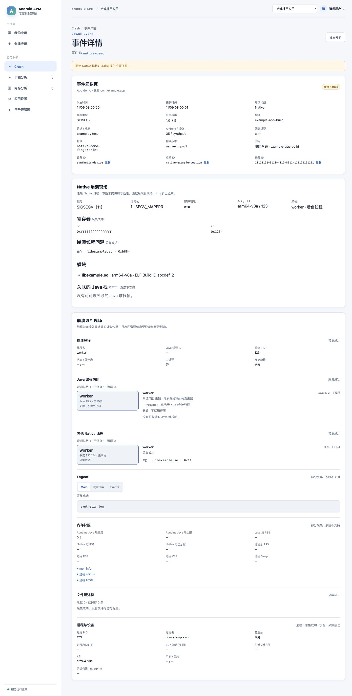

# Native Crash 验证

本页区分合成页面、模拟器采集和真实后端链路，避免把某一层验证扩大为完整验收。SO 符号表上传与还原不在本变更范围。

## 合成桌面页面

使用共享的 [Native 批次样例](../../examples/native-crash-batch.json)、只监听本机的 [预览接口](mock_preview.py) 和独立 Vite，检查了 1440 × 900 桌面视口。页面分别展示信号、零地址、寄存器、模块、原始回溯、关系未知的 Java 线程、Native 线程和共享诊断；未显示 JVM mapping 或 Native 分析操作。



复核时分别在仓库根目录和 `frontend/` 执行：

```bash
python3 docs/validation/native-crash/mock_preview.py
VITE_BACKEND_PROXY_TARGET=http://127.0.0.1:18731 npm run dev -- --host 127.0.0.1 --port 5178 --strictPort
```

在本机访问 `http://127.0.0.1:5178/apps/demo/crashes/events/native-demo`，结束后关闭两个进程。该截图使用合成 API，不证明真实设备、数据库或生产代理联调。

## API 35 模拟器的采集和恢复

在隔离的 Pixel 6 API 35 arm64 模拟器中，示例页分别触发主线程 JNI SIGSEGV、命名后台线程 JNI SIGSEGV、纯 Native 线程 SIGSEGV 和 SIGABRT。四次均因真实信号退出，重启后各导入一个原身份事件；主线程样本取得关联 Java 栈，后台及纯 Native 样本的 Java 线程关系为未知。队列包含原始 Native 栈、其他线程及可取得的日志、内存、FD、进程和设备分区，未出现三类禁止的转储。辅助进程超时和 Java 回调迟到另有隔离设备测试。

将四份模拟器生成的冻结事件提供给 `NativeCrashApiIntegrationTests.acceptsExplicitAndroidDeviceSamples` 后，隔离 MockMvc 接收校验通过。此测试不连接 ClickHouse，也不证明真实 HTTP 网络传输、网页或 MCP 对真实事件的联合查询。

## 隔离服务联合验证

在独立 PostgreSQL、ClickHouse、后端、网页和 MCP 容器中，分别在 API 29 和 35 的 arm64 模拟器触发主线程 JNI SIGSEGV。应用重启后各恢复并直接上传一条 Native 事件；ClickHouse、Agent HTTP 和 MCP 均可查询。两条事件的 MCP 堆栈和分段续读后的诊断与 Agent HTTP 返回内容一致。网页实际打开 API 35 事件，显示信号、寄存器、主栈、模块、Java 栈和诊断分区。

两台模拟器的日志、进程和设备分区可用；部分线程、内存或文件描述符分区因系统能力或大小限制标记为部分采集。检查实际返回内容没有 `stack` 原始栈内存、`memory near` 或完整 `memory map` 转储。本验证使用本机隔离数据，不代表物理设备和生产环境结果。

将一条模拟器冻结样本复制为隔离测试事件，通过本地代理转发写入后主动断开连接，再以原内容重试：服务端返回重复，ClickHouse 中仅有一条事实；同一事件 ID 更改内容后返回 `CRASH_CONTENT_CONFLICT`。该实验单独验证 HTTP/数据库幂等；客户端重试分支另由单元测试覆盖。

另在 API 29 模拟器对同一真实 Native 事件依次注入连接中断、HTTP 503、服务端写入后响应丢失和再次重试。四次观察到的事件内容摘要一致，最终返回重复确认、设备队列清空，ClickHouse 仅保存一条事实。为了缩短故障注入时间，测试只将队列的下次重试时间提前，未改动事件正文；因此不以本实验推断自然退避时长。辅助采集进程超时和 Java 回调中断、同构建 JVM mapping 变更分别由设备回归及后端测试覆盖。

复核时使用单独数据库、测试应用和本机监听地址，先应用全部 ClickHouse 初始化脚本，再为测试包名创建上报 Key 和只读查询 Token。向示例构建注入测试服务地址和 Key，在设备触发信号并重启后，核对队列恢复日志、ClickHouse 事实数量、网页事件详情、Agent HTTP 与 MCP `stack`/`diagnostics` 续页。故障代理应只用于隔离环境，并保持事件正文不变；不要将真实凭据或设备数据写入仓库。

Native 设备和单元回归可分别在 Android 工程中执行：

```bash
bash gradlew :performance-crash:testDebugUnitTest
ANDROID_SERIAL=<测试设备序列号> bash gradlew :performance-crash:connectedDebugAndroidTest
```

## 不同 Android 版本和独立消费者

API 29、35、36 的 arm64 模拟器各通过 14 项设备测试；API 21 通过 12 项，2 项 abort 消息测试按版本条件跳过。覆盖真实信号、独立回溯程序、超时、回调迟到、Java 文件描述符存活时的捕获，以及身份文件短暂不可读后同进程周期恢复。API 29/35/36 的纯 Native 线程 SIGABRT 测试验证安全消息和敏感消息首次落盘前省略；API 21 的消息采集尚未由该专项验证。API 21 的系统策略拒绝应用执行 logcat，日志分区按权限不足标记为不可用，其余可采集分区继续保留。

设备测试使用合成的 `X-App-Key` 和带标签两列栈内存日志，检查了 Native 暂存、冻结队列和上报正文；单元测试与服务端 MockMvc 另检查独立 APM 凭据脱敏及带标签转储拒绝。这些是针对样本的规则回归，不证明任意文本变体均可识别。

使用临时 Maven Local 发布坐标构建独立 Crash 消费者后，API 21 和 36 均实际运行 Release 包、触发 SIGSEGV、重启恢复出一条 Native 事件，并取得主栈、模块和 Java 栈。最终修复版本另在 API 35 Release 包执行 SIGSEGV 和重启恢复，取得主栈与模块；此前 API 35 还验证了捕获后关闭 Native 开关，新进程仍恢复此前事件。这里验证的是 arm64 模拟器；其他 ABI 的实际执行、物理设备及生产环境仍待验证。
